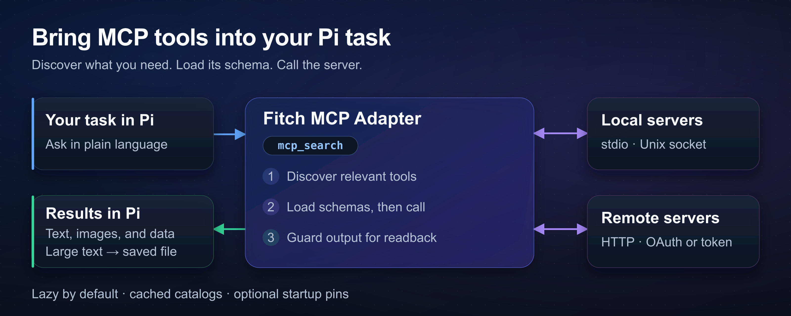

# Fitch MCP Adapter

Connect [Pi](https://github.com/earendil-works/pi) to MCP servers for browsers, databases, and APIs. The adapter loads selected tool schemas when needed to keep large catalogs out of the conversation context.



## Install

Use Pi 1.0.0 or later and Node.js 24 or later.

```bash
pi install npm:@fitchmultz/pi-mcp-adapter
pi
```

Restart Pi if it was open during installation. Load only one adapter per Pi host. For pre-v5 state, read the [upgrade guide](docs/migration.md) before you restart Pi.

For a Git install, run `pi install git:github.com/fitchmultz/pi-mcp-adapter`.

## First use

Enter `/mcp setup` to add a server or import configs from other hosts. Preview the changes before you save them. The adapter leaves external host files unchanged.

The adapter reads `.mcp.json` and `~/.config/mcp/mcp.json` automatically. Pi loads project configs only after project trust. See [config paths and precedence](docs/reference.md#quick-start).

For Chrome DevTools, create `.mcp.json` in your project:

```json
{
  "mcpServers": {
    "chrome-devtools": {
      "command": "npx",
      "args": ["-y", "chrome-devtools-mcp"]
    }
  }
}
```

Run `/reload` after config changes. Ask Pi:

> Use Chrome DevTools to take a screenshot of the current page.

By default, servers connect when Pi discovers an uncached catalog or calls a tool. Cached catalogs remain searchable without a connection.

## Controls and settings

| Command | Purpose |
| --- | --- |
| `/mcp` | Show servers and pin tools |
| `/mcp status` | Show connection state and tool/resource counts |
| `/mcp reconnect <server>` | Reconnect and refresh the catalog |
| `/mcp-auth <server>` | Start OAuth in an interactive session |
| `/mcp disable <server>` | Disable the server for this project; apply with `/reload` |
| `/mcp enable <server>` | Enable the server for this project; apply with `/reload` |

Use [`directTools`](docs/reference.md#typed-discovery-and-pinned-tools) to pin tools at startup. Other tools remain available for discovery. Global search covers known catalogs; select a server to discover an unknown catalog.

Use [`approveTools`](docs/reference.md#tool-approval) to require confirmation before sensitive calls. Matching calls fail in headless sessions without approval.

## More server features

The adapter supports [resources](docs/reference.md#mcp-resources) and [prompt templates](docs/reference.md#mcp-prompts). Prompt commands use `/mcp__<server>__<prompt>` names.

[MCP Apps](docs/reference.md#mcp-ui-integration) open interactive UIs in a browser or through [Glimpse](https://github.com/hazat/glimpse) on macOS. Apps can send messages to Pi. Try the [interactive visualizer](examples/interactive-visualizer/README.md).

Use [`mcp_script`](docs/reference.md#mcp-scripting) for loops and dependent tool calls. See [gateway examples](docs/reference.md#usage) for exact call shapes.

## Warnings and platform limits

MCP servers can execute programs or access accounts. Check server commands and account access before you trust a project config.

OAuth requires an available OS credential store. Unlock a Secret Service-compatible keyring on headless Linux. The adapter has no plaintext fallback. See the [OAuth guide](OAUTH.md) for remote sign-in.

Android and Termux do not support persistent OAuth by default. Unauthenticated, header-token, and stdio servers work. Git/source builds require an Android-native `tsgo` compiler. Use the precompiled npm package if you have no compiler. See [Android build details](docs/development.md#androidtermux-source-builds).

The adapter saves text above the default 50 KiB or 2,000-line limit to local files. Saved results and App histories can contain sensitive data. Remove files when you no longer need them. See [output handling and readback](docs/reference.md#output-guard).

If App history cannot be saved, reload or exit discards unsaved messages. Retrieve pending messages before either action. See [App history and recovery](docs/reference.md#mcp-ui-integration).

## Documentation

- [Reference](docs/reference.md): all settings, tool actions, SDK integration, transport behavior, and limits.
- [Upgrade guide](docs/migration.md): API changes and pre-v5 state migration.
- [Development and releases](docs/development.md): local checks and maintainer procedures.
- [Changelog](CHANGELOG.md) · [Report an issue](https://github.com/fitchmultz/pi-mcp-adapter/issues)

## License and background

Mitch Fultz maintains Fitch MCP Adapter under the [MIT license](LICENSE). Mario Zechner discusses tool schema costs in [his article about MCP](https://mariozechner.at/posts/2025-11-02-what-if-you-dont-need-mcp/).

[Watch the adapter demo](https://github.com/user-attachments/assets/4b7c66ff-e27e-4639-b195-22c3db406a5a).
