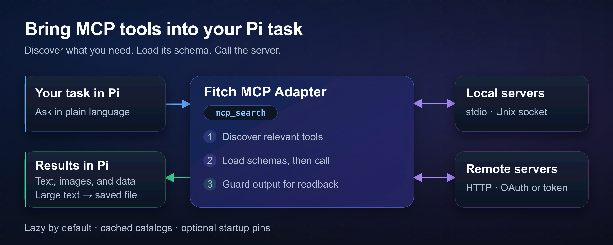

# Fitch MCP Adapter

Connect [Pi](https://github.com/earendil-works/pi) to MCP servers for browsers, databases, and APIs. The adapter loads selected tool schemas when needed to keep large catalogs out of the conversation context.



## Install

Check the [Pi and Node.js requirements](https://github.com/fitchmultz/pi-mcp-adapter/blob/main/docs/reference.md#requirements).

```bash
pi install npm:@fitchmultz/pi-mcp-adapter
pi
```

Restart Pi if it was open during installation. Load only one adapter per Pi host. For legacy adapter state, read the [upgrade guide](docs/migration.md) before you restart Pi.

For a Git install, run `pi install git:github.com/fitchmultz/pi-mcp-adapter`.

## First use

Enter `/mcp setup` to add a server or import configs from other hosts. Preview the changes before you save them. The adapter leaves external host files unchanged.

The adapter reads `.mcp.json`, project `.pi/mcp.json` (read-only native Pi format when no other Pi MCP extension is coexisting in the session), and `~/.config/mcp/mcp.json` automatically. Pi loads project configs only after project trust. See [config paths and precedence](docs/reference.md#quick-start).

For Chrome DevTools, create `.mcp.json` in your project:

```json
{
  "mcpServers": {
    "chrome-devtools": {
      "command": "npx",
      "args": ["-y", "chrome-devtools-mcp"]
    }
  }
}
```

Run `/reload` after config changes. Ask Pi:

> Use Chrome DevTools to take a screenshot of the current page.

By default, servers connect when Pi discovers an uncached catalog or calls a tool. Enabled servers appear in a cache-stable `<mcp_servers>` prompt section with their description or instructions summary, and cached catalogs register as deferred Pi tools (`mcp__<server>__<tool>` by default) without a connection: Pi's `tool_search` loads the ones a task needs, `codemode` scripts can call them directly, and the `mcp` gateway discovers servers that have no cached catalog yet.

## Controls and settings

| Command                   | Purpose                                                               |
| ------------------------- | --------------------------------------------------------------------- |
| `/mcp`                    | Open the interactive server and pin panel                             |
| `/mcp status`             | Show connection state, blocked/disabled servers, and validation notes |
| `/mcp tools [server]`     | List discovered tools and estimated token cost (all or one server)    |
| `/mcp reconnect [server]` | Reconnect and refresh the catalog (skips disabled servers)            |
| `/mcp reload`             | Reload MCP configuration and runtime state                            |
| `/mcp doctor [server]`    | Inspect config sources, validation errors, auth health, and stderr    |
| `/mcp-auth <server>`      | Start OAuth in an interactive session                                 |
| `/mcp disable <server>`   | Disable the server live in-session and in project overrides           |
| `/mcp enable <server>`    | Enable the server live in-session and connect/register its tools      |

Use [`directTools`](docs/reference.md#typed-discovery-and-pinned-tools) to pin tools at startup. Other tools stay deferred until `tool_search` loads them. Like Pi's own MCP extension, the adapter activates a registered `tool_search` when it registers deferred tools, once per session start or tree navigation; a branch that recorded removing `tool_search` keeps it off. Gateway search covers known catalogs; `mcp({ action: "connect", server })` discovers an unknown catalog.

Use [`approveTools`](docs/reference.md#tool-approval) to require confirmation before sensitive calls. Matching calls fail with `isError: true` in headless sessions or when denied, and concurrent prompts for the same tool serialize cleanly.

## More server features

The adapter supports [MCP Skills](docs/reference.md#mcp-skills) (verified SEP-2640 skills auto-discovered for trusted projects into Pi's `resources_discover`, on by default via `exposeSkills`), [resources and URI templates](docs/reference.md#mcp-resources) (`resources` / `read-resource`), and [prompt templates](docs/reference.md#mcp-prompts) (slash commands under `/mcp__<server>__<prompt>` with MCP argument completions, plus `prompts` / `get-prompt` gateway actions).

[MCP Apps](docs/reference.md#mcp-ui-integration) open interactive UIs in a browser or through [Glimpse](https://github.com/hazat/glimpse) on macOS. Apps can send messages to Pi. Try the [interactive visualizer](examples/interactive-visualizer/README.md).

Use Pi's `codemode` tool for [loops and dependent tool calls](docs/reference.md#multi-call-work). See [gateway examples](docs/reference.md#usage) for exact call shapes.

## Warnings and platform limits

MCP servers can execute programs or access accounts. Check server commands and account access before you trust a project config.

OAuth requires an available OS credential store. Unlock a Secret Service-compatible keyring on headless Linux. The adapter has no plaintext fallback. See the [OAuth guide](OAUTH.md) for remote sign-in.

Android and Termux do not support persistent OAuth by default. Unauthenticated, header-token, and stdio servers work. Git/source builds require an Android-native `tsgo` compiler. Use the precompiled npm package if you have no compiler. See [Android build details](docs/development.md#androidtermux-source-builds).

The adapter saves text above the default 50 KiB or 2,000-line limit to local files. Saved results and App histories can contain sensitive data. Remove files when you no longer need them. See [output handling and readback](docs/reference.md#output-guard).

If App history cannot be saved, reload or exit discards unsaved messages. Retrieve pending messages before either action. See [App history and recovery](docs/reference.md#mcp-ui-integration).

## Documentation

- [Reference](docs/reference.md): all settings, tool actions, SDK integration, transport behavior, and limits.
- [Upgrade guide](docs/migration.md): API changes and legacy state migration.
- [Development and releases](docs/development.md): local checks and maintainer procedures.
- [Changelog](CHANGELOG.md) · [Report an issue](https://github.com/fitchmultz/pi-mcp-adapter/issues)

## License and background

Mitch Fultz maintains Fitch MCP Adapter under the [MIT license](LICENSE). Mario Zechner discusses tool schema costs in [his article about MCP](https://mariozechner.at/posts/2025-11-02-what-if-you-dont-need-mcp/).

[Watch the adapter demo](https://github.com/user-attachments/assets/4b7c66ff-e27e-4639-b195-22c3db406a5a).
